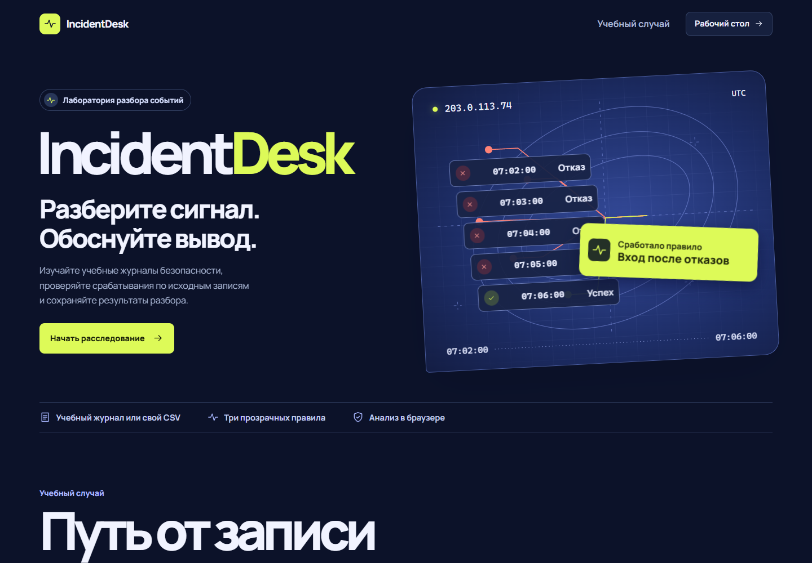
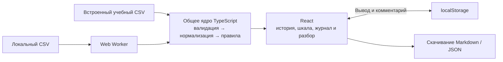

# IncidentDesk

Учебное веб-приложение для анализа журналов аутентификации. Оно группирует события по трём правилам, показывает исходные записи и помогает зафиксировать вывод. Срабатывание отвечает на вопрос «что проверить?». Решение принимает человек с учётом дополнительного контекста.

[Открыть демо на GitHub Pages](https://rompel2000.github.io/incidentdesk/)



## Что можно попробовать

- Пройти историю одного входа или сразу открыть рабочий стол с синтетическим журналом.
- Загрузить учебный CSV, изучить временную шкалу и отфильтровать журнал по пользователю, IP, типу и результату.
- Открыть предупреждение, посмотреть порог, подтверждающие записи и проверить гипотезу.
- Сохранить вывод и комментарий в браузере. Выгрузить разобранные предупреждения в Markdown или JSON. Удалить один вывод или все локальные выводы.

[Рабочий стол](docs/workspace.png) · [Боковая панель разбора](docs/investigation.png) · [Вид на телефоне](docs/mobile.png)

## Запуск с нуля

Установите Node.js 24 с npm. В корне проекта выполните команды и откройте адрес, который выведет Vite.

```sh
npm ci
npm run dev
```

Собрать и проверить итоговую сборку можно так:

```sh
npm test
npm run build
npm run preview
```

Для сквозных тестов установите Chromium для Playwright и завершите ручной preview, если он использует порт 4173. Playwright сам поднимет preview итоговой сборки в подпапке `/incidentdesk/`.

```sh
npx playwright install chromium
npm run test:e2e
```

На Windows можно запустить те же тесты в установленном Edge через `$env:PW_BROWSER_CHANNEL='msedge'` в PowerShell. Для обновления скриншотов перед тестами задайте `UPDATE_SCREENSHOTS=1`. В Linux для установки браузерных системных пакетов при необходимости используйте `npx playwright install --with-deps chromium`.

## Архитектура

React + TypeScript + Vite публикуются как статические файлы. Web Worker читает загруженный файл и запускает те же функции, которые готовят демонстрацию. Worker выполняется независимо от основного потока интерфейса. Визуальные переходы реализованы через CSS, а смену сцен при прокрутке определяет IntersectionObserver.



| Точка входа | Назначение |
| --- | --- |
| [csv.ts](src/csv.ts) | Валидация CSV, приведение времени к UTC, канонизация IP, повторы |
| [detection.ts](src/detection.ts) | Группировка, скользящие окна, подтверждающие события |
| [analysis.ts](src/analysis.ts) | Результат анализа и устойчивый ключ набора данных |
| [import.worker.ts](src/import.worker.ts) | Обработка локального файла в Worker |
| [review.ts](src/review.ts) | Локальные выводы, удаление, экспорт |
| [Desk.tsx](src/Desk.tsx) | Рабочий стол, управление разбором и журналом |

Сервер и база данных в этой версии не требуются. Статическая сборка анализирует пользовательские файлы тем же кодом, что и локальный запуск.

## Данные и пределы метода

[Формат, точная семантика правил и пояснения к учебному журналу](docs/detection.md).

CSV остаётся в памяти вкладки до смены источника или перезагрузки и не отправляется во внешние сервисы. Размер до 1 МиБ включительно, до 10 000 строк с событиями до удаления повторов. При ошибке прежний журнал остаётся доступен. Успешный повторный импорт сбрасывает экран и фильтры, но восстанавливает сохранённые выводы, если нормализованный набор событий совпадает.

В `localStorage` остаются ключ набора, идентификатор предупреждения, вывод, комментарий и время сохранения. Срок хранения не ограничен приложением. Выводы доступны в текущем профиле браузера для этого origin, не синхронизируются между устройствами и могут исчезнуть при очистке сайта или завершении приватной сессии. На общем профиле браузера выводы будут доступны следующему пользователю этого профиля. В настройках рабочего стола можно удалить все выводы проекта. Скачанный отчёт содержит записи, пользователя, IP и комментарии, и после скачивания управляется как обычный локальный файл.

Три правила используют только пять полей CSV. В нём нет устройства, MFA, географии, истории смены пароля и действий внутри сессии. Общий IP может представлять несколько устройств. Одинаковые записи без идентификатора источника сворачиваются. Из-за этого часть реальных повторов может исчезнуть из расчёта. Серьёзность показывает приоритет ручной проверки.

## GitHub Pages

В Vite используется относительная база `./`, а маршруты `#desk`, `#story` и `#case` работают в одном HTML-файле. Статические ресурсы, CSV и Worker остаются внутри подпапки. Для браузерного SHA-256 нужны HTTPS или localhost.

Для нового репозитория выберите **Settings → Pages → Build and deployment → Source → GitHub Actions**. [Workflow](.github/workflows/pages.yml) проверяет pull request, а при пуше в `main` устанавливает зависимости из lockfile, запускает тесты и публикует `dist` после успешной проверки. Если первый пуш был раньше настройки Pages, workflow можно запустить вручную из Actions. [Документация Vite по GitHub Pages](https://vite.dev/guide/static-deploy.html#github-pages).

## Проверки и подготовка к демонстрации

- [Модульные тесты](tests/domain.test.ts) проверяют пороги, включение границ, объединение, сброс после входа, нормализацию, обычные сценарии, ложное срабатывание, ошибки, лимиты, хранение и два формата экспорта.
- [Сквозные тесты](tests/incidentdesk.spec.ts) проверяют путь от истории до отчёта, импорт, восстановление выводов, удаление, мобильную вёрстку, клавиатурный фокус и уменьшенное движение. Локальный прогон выполнен в Edge в Windows на размерах 1440×1000 и 390×844. Мобильный размер проверялся в эмуляции.
- [Сценарий собеседования, вопросы, вклад и идеи развития](docs/interview.md).

Шрифт Manrope включён локально через Fontsource и распространяется по [SIL Open Font License](docs/manrope-OFL.txt). Графика проекта создана средствами SVG и CSS.
